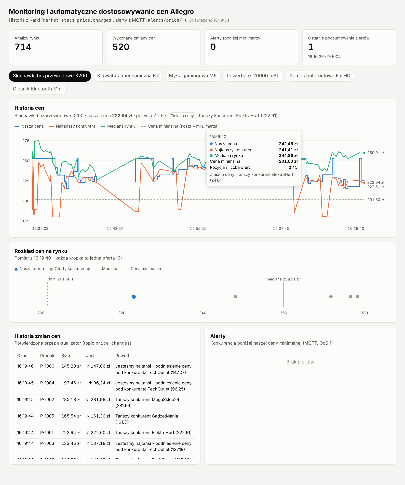
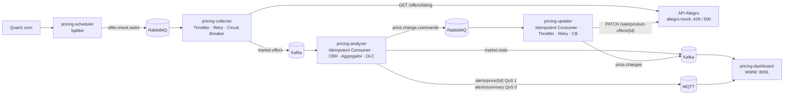

# Monitoring i automatyczne dostosowywanie cen ofert Allegro

Projekt z przedmiotu **Integracja Systemów Przedsiębiorstw (ISP)**: asynchroniczny system, który cyklicznie
sprawdza ceny konkurencji na Allegro, liczy statystyki rynku i — pilnując minimalnej marży — sam koryguje
cenę naszej oferty albo alarmuje człowieka.

Stos: **Apache Camel 3.22** (trasy i wzorce EIP) · **Apache Karaf 4.4** (każdy moduł to bundle OSGi) ·
**RabbitMQ** (zadania i komendy) · **Apache Kafka** (strumień zdarzeń i historia cen) · **MQTT / Mosquitto** (alerty).



## Architektura



| Moduł (bundle OSGi) | Rola | Wejście → wyjście |
|---|---|---|
| `pricing-common` | model komunikatów, silnik reguł, definicje endpointów, polityka retry i Circuit Breaker | — |
| `pricing-scheduler` | co 20 s czyta `etc/products.json` i dzieli listę na pojedyncze zadania | Quartz → RabbitMQ `offer.check.tasks` |
| `pricing-collector` | odpytuje API Allegro, publikuje surową odpowiedź | RabbitMQ → HTTP → Kafka `market.offers` |
| `pricing-analyzer` | statystyki (min, mediana, pozycja) i decyzja | Kafka → Kafka `market.stats` + RabbitMQ `price.change.commands` / MQTT |
| `pricing-updater` | wysyła zmianę ceny do API Allegro, zapisuje potwierdzenie | RabbitMQ → HTTP → Kafka `price.changes` |
| `pricing-dashboard` | historia cen, rozkład cen, zmiany, alerty | Kafka + MQTT → HTTP `:8091` |
| `allegro-mock` | symulowany rynek w kształcie REST API Allegro, losowe 429/500 | HTTP `:8090` |
| `pricing-features` | repozytorium feature'ów Karafa | — |
| `pricing-distribution` | gotowa dystrybucja Karafa z zainstalowanym systemem | — |

### Silnik reguł

`cena minimalna = koszt zakupu × (1 + minimalna marża %)` (zaokrąglona w górę do grosza).

| Sytuacja | Decyzja | Skutek |
|---|---|---|
| najtańszy konkurent poniżej naszej ceny minimalnej | `ALERT` | MQTT `alerts/price/{productId}` |
| ktoś jest tańszy, marża pozwala | `CHANGE_PRICE` na `max(cena konkurenta − 0,01; cena minimalna)` | komenda na RabbitMQ |
| jesteśmy najtańsi z zapasem ≥ 0,5 % (`pricing.raiseEnabled`) | `CHANGE_PRICE` w górę, tuż pod konkurenta | komenda na RabbitMQ |
| pozostałe | `HOLD` | tylko statystyki |

Zdarzenia starsze niż `pricing.maxEventAgeMs` (nadrabianie zaległości z Kafki) trafiają do historii, ale nie
wywołują już komend ani alertów. Logika jest w `PricingEngine` (czysta Java, testy w `PricingEngineTest`).

## Wzorce EIP — gdzie ich szukać

| Wzorzec | Gdzie | Po co |
|---|---|---|
| **Splitter** | `SchedulerRoutes` | lista produktów → niezależne zadania |
| **Throttler** | `CollectorRoutes`, `UpdaterRoutes` | limit zapytań/s do API Allegro |
| **Content-Based Router** | `AnalyzerRoutes` (`choice`) | decyzja → RabbitMQ / MQTT / nic |
| **Idempotent Consumer** | `AnalyzerRoutes` (po `eventId`), `UpdaterRoutes` (po `commandId`) | brokery dostarczają *at-least-once*; ceny nie wolno zmienić dwa razy |
| **Aggregator** | `AnalyzerRoutes`, trasa `alert-digest` | alerty z okna 30 s → jedno podsumowanie |
| **Dead Letter Channel** | `AnalyzerRoutes` → topic `market.offers.dlt`; kolejki `*.dlq` w RabbitMQ | komunikat nie do przetworzenia nie blokuje reszty |
| **Retry** | `HttpResilience.retryPolicy` | 429: stała dłuższa przerwa; 5xx i błędy sieci: backoff wykładniczy; pozostałe 4xx: bez ponowień |
| **Circuit Breaker** | `QueueCircuitBreaker` (RoutePolicy) | po 5 błędach w 30 s wstrzymuje konsumenta kolejki; po 15 s próba (half-open) |

Uwaga o Circuit Breakerze: `camel-resilience4j` nie ma feature'a dla Karafa w Camelu 3.x, a wbudowana
`ThrottlingExceptionRoutePolicy` zakleszcza się z konsumentem RabbitMQ (zatrzymuje go z jego własnego wątku).
Stąd własna, krótka polityka: stop/start konsumenta robi osobny wątek, a komunikat, na którym obwód się
otworzył, wraca do kolejki zamiast do DLQ.

## Role brokerów — porównanie

| | RabbitMQ | Apache Kafka | MQTT (Mosquitto) |
|---|---|---|---|
| Co niesie | zadania i komendy („zrób to raz”) | zdarzenia („to się wydarzyło”) | alerty dla ludzi/urządzeń |
| Model | kolejka robocza, komunikat znika po `ack` | trwały log, wielu niezależnych czytelników, odczyt od dowolnego offsetu | pub/sub po hierarchii tematów (`alerts/price/+`) |
| Użyte cechy | `ack` ręczny po całej trasie, kolejki `durable` + komunikaty trwałe, DLX/DLQ, requeue, prefetch | klucz = `productId` (kolejność w partycji), grupy konsumentów, retencja 7 dni, replay (`seekTo=beginning` w dashboardzie) | QoS 1 + trwała sesja dla alertów, QoS 0 + `retained` dla podsumowania |
| Błędy | ponowienia w Camelu → `nack` → `*.dlq` | Dead Letter Channel → `market.offers.dlt` | — |
| Dlaczego tu | każde zadanie ma wykonać dokładnie jeden worker, z ponowieniem i odkładaniem błędnych | analizator i dashboard czytają to samo niezależnie; historia cen odtwarza się po restarcie | lekki protokół, subskrypcja wzorcem, broker kolejkuje alerty nieobecnemu odbiorcy |

**QoS w MQTT:** pojedynczy alert idzie z QoS 1 (*at least once* — nie może zginąć, duplikat nie szkodzi), a dashboard
subskrybuje z `cleanSession=false`, więc broker przechowa alerty z czasu jego nieobecności. Podsumowanie idzie z
QoS 0 (*at most once*) i flagą `retained` — zgubione zastąpi następne, a nowy subskrybent od razu dostaje ostatnie.
QoS 2 nie jest potrzebny: alerty są idempotentne dla odbiorcy.

## Uruchomienie

Wymagania: Docker z Compose; do budowania lokalnego JDK 11+ (testowane na 17 i 21) i Maven 3.9.

**Wszystko w kontenerach**

```bash
docker compose up --build
```

**Brokery w Dockerze, Karaf lokalnie** (wygodne przy pracy nad kodem)

```bash
docker compose up -d rabbitmq kafka mosquitto
```

```bash
mvn clean install
```

```bash
pricing-distribution/target/assembly/bin/karaf
```

| Adres | Co |
|---|---|
| http://localhost:8091 | dashboard |
| http://localhost:8090/offers/listing?phrase=P-1001 | mock API Allegro |
| http://localhost:15672 | panel RabbitMQ (guest / guest) |
| `ssh -p 8101 karaf@localhost` | konsola Karafa (hasło `karaf`) |

### Karaf

```text
bundle:list -s | grep allegro      # bundle systemu
feature:list | grep pricing        # feature'y
camel:route-list                   # trasy i liczniki
bundle:stop pl.isp.allegro.allegro-mock    # symulacja awarii API
log:tail
```

Każdy moduł to osobny feature (`pricing-scheduler`, `pricing-collector`, …; całość: `allegro-pricing`), więc można
je instalować i zatrzymywać niezależnie. Do „gołego” Karafa:

```text
feature:repo-add mvn:pl.isp.allegro/pricing-features/1.0.0-SNAPSHOT/xml/features
feature:install allegro-pricing
```

### Konfiguracja

`etc/pl.isp.allegro.cfg` (ConfigAdmin, PID `pl.isp.allegro`); zapis pliku przeładowuje konteksty Camela bez
restartu Karafa. Adresy brokerów i API można nadpisać zmiennymi środowiskowymi (`RABBITMQ_HOST`, `KAFKA_BROKERS`,
`MQTT_HOST`, `ALLEGRO_API_URL`, `ALLEGRO_API_TOKEN`, `SCHEDULER_CRON`, `MOCK_ERROR_429_RATE`, `MOCK_ERROR_500_RATE`).
Lista produktów: `etc/products.json` (czytana przy każdym cyklu).

Prawdziwe API Allegro: ustaw `ALLEGRO_API_URL=https://api.allegro.pl` i token OAuth w `ALLEGRO_API_TOKEN`.
Mock odwzorowuje kształt `GET /offers/listing` i `PATCH /sale/product-offers/{id}`; odświeżanie tokenu OAuth
i dostęp do listingu (wymaga weryfikacji aplikacji przez Allegro) są poza zakresem projektu.

## Scenariusze demonstracyjne (odporność)

1. **Limity i błędy API (429/500).** Mock zwraca je losowo (15 % / 10 %). W logu: `On delivery attempt: 1 caught: HttpOperationFailedException`, po czym `Kolektor: P-1003 -> market.offers`.
2. **Awaria API → Circuit Breaker.** `bundle:stop pl.isp.allegro.allegro-mock`. W logu: `Circuit breaker [collector]: OPEN`, potem co 15 s `HALF_OPEN`. Zadania rosną w kolejce `offer.check.tasks`, do `offer.check.tasks.dlq` trafiają tylko te sprzed otwarcia obwodu. Po `bundle:start …`: `CLOSED` i kolejka się opróżnia.
3. **Awaria RabbitMQ.** `docker compose stop rabbitmq`, po chwili `start`. Klient AMQP sam odtwarza połączenie i topologię; kolejki i komunikaty są trwałe.
4. **Awaria Kafki.** `docker compose stop kafka`. Kolektor nie potwierdza zadań (zostają w RabbitMQ lub trafiają do DLQ po ponowieniach), po powrocie konsumenci wznawiają od zapisanych offsetów.
5. **Poison message.** Wyślij śmieci na `market.offers` — po 2 ponowieniach komunikat ląduje na `market.offers.dlt` z nagłówkiem `dlt.reason`:
   ```bash
   docker compose exec kafka sh -c 'echo "to nie JSON" | /opt/kafka/bin/kafka-console-producer.sh --bootstrap-server localhost:29092 --topic market.offers'
   ```
6. **Historia w Kafce.** Zrestartuj bundle `pricing-dashboard` — wykresy odtwarzają się z topiców od początku.
7. **Alerty MQTT.** `docker compose exec mosquitto mosquitto_sub -t 'alerts/#' -v`

## Testy

```bash
mvn test
```

`PricingEngineTest` (reguły i statystyki), `QueueCircuitBreakerTest`, `CollectorRoutesTest` (retry 429/500/4xx),
`AnalyzerRoutesTest` (router, idempotencja, agregator, Dead Letter Channel) — trasy testowane z brokerami
podmienionymi na `direct:` / `mock:`.

## Ograniczenia

- Repozytoria Idempotent Consumera są w pamięci (giną przy restarcie bundla); produkcyjnie: JDBC lub Kafka.
- Stan dashboardu jest w pamięci i odtwarzany z Kafki.
- Pojedyncze instancje brokerów, bez uwierzytelniania — konfiguracja laboratoryjna.
